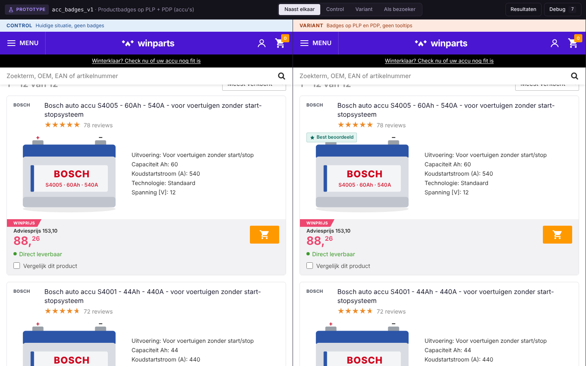

# Prototype productbadges accu's

Prototype voor het experiment met drie productbadges ("Best beoordeeld", "Minst geretourneerd" en "Winparts keuze") op de productlijst en productpagina van de categorie accu's. Gemaakt voor de Growth Engineer opdracht van Winparts.



## Starten

Node 20 of hoger.

```bash
npm install
npm run dev
```

Open daarna http://localhost:5173.

## Wat zit erin

De donkere balk bovenin hoort bij het prototype, niet bij de shop.

- **Naast elkaar**: control links, variant rechts. Het enige verschil zijn de badges.
- **Control / Variant**: één variant schermvullend, zoals je die in QA zou forceren.
- **Als bezoeker**: de variant die je echt zou krijgen. Bezoekers worden 50/50 verdeeld op basis van een hash van hun id.
- **Debug**: waarom een product een badge krijgt, en alle tracking-events live.
- **Resultaten**: gesimuleerd verkeer van vier weken en hoe je de uitkomst zou uitlezen, plus je eigen kliks.

Een weergave kan ook via de URL: `?exp=compare`, `?exp=control`, `?exp=variant` of `?exp=assigned`.

## Hoe het werkt

```
src/
  data/products.ts            12 accu's met fictieve ratings, verkoop en retouren
  experiment/
    config.ts                 Experiment, badges en de badgeregels
    assignment.ts             Bezoeker naar bucket 0-99, en bucket naar control of variant
    badges.ts                 Welk product welke badge krijgt
    ExperimentContext.tsx     Welke variant een pagina toont, en de vaste velden voor elk event
    tracking.ts               Events in GA4-stijl, ook naar window.dataLayer
  pages/                      Productlijst, productpagina en resultaten
  simulation/                 Gesimuleerd verkeer en de statistiek
  results/                    Grafieken en het tellen van je eigen kliks
```

**Badges.** Berekend over de hele categorie, zodat een product overal dezelfde badge heeft. Alleen producten op voorraad doen mee.

- Best beoordeeld: hoogste gewogen rating (Bayesiaans gemiddelde), minimaal 25 reviews.
- Minst geretourneerd: laagste retourpercentage over 90 dagen, minimaal 100 verkocht. Retouren door een verkeerde pasvorm tellen standaard niet mee.
- Winparts keuze: gekozen door de categoriemanager, minimaal 4,3 sterren, en niet op een product dat al een badge heeft.

**Tracking.** Elk event krijgt het experiment, de variant en de bucket mee. Bij productkliks staat ook welke badges getoond werden en op welke badges het product recht heeft. Dat laatste ook in control, zodat je kliks op dezelfde producten eerlijk kunt vergelijken.

**Simulatie.** Elke gesimuleerde bezoeker gaat door dezelfde 50/50-verdeling, scrolt door de lijst en klikt of haakt af. Na een klik volgen kansen op winkelwagen en aankoop. Hoeveel effect een badge heeft staat vast in `src/simulation/simulate.ts`, het zijn dus geen echte resultaten. Met de schuif op de resultatenpagina verander je het verkeer per dag. Dezelfde seed geeft altijd dezelfde uitkomst.

## Wat dit niet is

Geen productiecode en alle cijfers zijn verzonnen. In productie zou de toewijzing via een cookie op de server gebeuren, zouden de badges uit een nachtelijke feed komen en zouden de events via GTM naar GA4 gaan.
